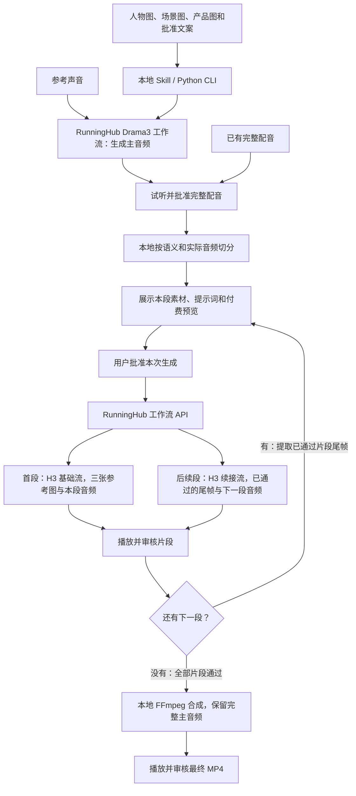

# 数字人口播视频 Skill

用人物图、产品图、场景图和文案，经过音频审核、分段生成、尾帧续接，产出可审核的竖屏 MP4。运行于支持本地 Python 脚本的 Agent；通过自己的 RunningHub 工作流调用 Drama3 TTS 和 MiniMax H3。

**当前为测试版：代码与离线流程已实现，当前账号已通过会员 Key 实际生成 H3 首段视频；首段画面质量尚待人工验收，真实续接及完整成片尚未验证。** 本仓库不附带工作流账号权限、API 密钥、模型权重或生产素材。生产入口为 Skill 与 CLI，另有本机只读审片工作台。

## 调用关系



H3 两条流在 RunningHub 的 ComfyUI 环境加载模型权重并生成视频，Skill 调用的是工作流 API。本仓库没有直连 MiniMax 官方视频 API。MiniMax Speech 等其他工具产出的音频可作为“已有完整配音”导入；内置 TTS 路线是 Drama3 工作流。云端所需模型和节点见[依赖清单](references/setup.md#导入后检查哪些依赖)。

## 安装与开始

将本仓库整个目录作为一个名为 `talking-head-video` 的 Skill 安装到 Agent 的技能目录。入口为 [SKILL.md](SKILL.md)，目录内脚本和 references 需一起保留。需要 Python 3.9+ 与 FFmpeg；没有 FFmpeg 时可用：

```sh
python3 -m pip install imageio-ffmpeg
python3 scripts/talking_head.py doctor
```

按照 [配置说明](references/setup.md)导入所需工作流，填入自己的 ID，并在启动进程中配置 `RUNNINGHUB_API_KEY`。视频使用 H3 基础流和续接流；需要从参考声音生成配音时另配 Drama3 TTS，已有完整配音可跳过它。先只读检查工作流，再使用自己的合法素材生成校准样片。完整命令见 [CLI](references/cli.md)。

Agent 中可这样开始：

> 使用 $talking-head-video，用我提供的人物图、场景图、商品图和文案制作数字人口播。先展示内容，音频和视频分别审核；每次付费生成前展示当前任务。

也可直接提供已录好的完整 `audio`，跳过 TTS。文案与录音必须一致。示例草稿为 [plan.example.json](examples/plan.example.json)，素材路径是占位示例，需替换。

## 本地审片工作台

```sh
python3 scripts/talking_head.py serve
```

命令输出本机访问地址，例如 `http://127.0.0.1:52704`，在浏览器打开；终端保持运行，按 Ctrl+C 停止。默认由系统分配端口，也可用 `serve --port 8789` 固定端口。它与 CLI 共用配置和任务目录，`--config`、`--data-dir` 仍放在子命令前。

工作台显示真实的本地任务、参考图、完整口播、配音与分段试听、视频与最终成片，以及当前批准是否有效和生成日志。切换任务或点击“刷新任务”读取最新状态；它不会查询云端任务，不会自动刷新或打断正在播放的媒体。只有已登记且位于对应任务目录内的媒体可播放。

这是只读审片入口：创建、修改、批准、提交、恢复查询和合成仍由 Skill / CLI 完成。打开页面不上传素材、不生成媒体、不改变批准记录。服务只监听 `127.0.0.1`；页面中的 Key 状态仅表示当前进程是否配置，不显示密钥，也不证明平台权限和余额可用。

## 已实现

- 本地素材导入及内容、音频、分段、提示词、片段、成片的版本审核。
- 实测音频时长，停顿辅助切分；每段 2–15 秒，需试听核对语义。
- 三参考图基础流和已审核尾帧续接；两种视频工作流分别做竖屏校准。
- 付费提交前意图日志、平台任务 ID 保存、结果查询、下载恢复与显式重做。
- 最终按驱动音频切点对齐画面，输出 1080×1920 / 24fps MP4，保留完整批准主音频。

它不自动判断口型、人物一致性、产品变形或事实准确性。没有自动发布、投放或飞书资产库集成。

## 验证

```sh
python3 -m unittest discover -s tests -v
```

回归使用模拟网络与真实 WAV、FFmpeg 视频处理，不会调用 RunningHub 或扣费。覆盖完整 TTS→基础片段→续接→合成流程，以及超时防重复提交、断点恢复、旧批准失效和句尾音频保留。测试通过不能替代真实账号、实际工作流和画面质量验收。

安装回归还会把 Skill 复制到含中文与空格的新目录，在源码目录之外通过 CLI 创建任务、导入已有配音、人工切点分段、审核提示词并生成首段付费预览，同时验证参考声音的 TTS 预览。测试使用临时配置和合成素材，不继承用户密钥，并阻止子进程联网；这验证本地安装与准备流程，不证明另一台机器或另一账号已成功生成视频。

2026-11-08 的实际接入进度：

| 环节 | 已取得的证据 | 尚未证明 |
| --- | --- | --- |
| 工作流和素材接口 | 当前账号三个 API 图通过节点和连线核验；PNG、WAV 上传成功 | 其他账号具备同样权限；Drama3 和续接流实际推理成功 |
| 本次采用的配音 | 通过 RunningHub 标准模型接口生成 MiniMax Speech 2.8 HD 音频，并人工试听采用 | 内置 Drama3 工作流生成成功；MiniMax TTS 已成为内置选项 |
| H3 首段 | 经单独批准的新校准任务，通过消费级会员 Key 和基础工作流生成并下载 MP4：768×1376、24fps、3.04 秒；此前无平台 ID 的 605 提交仍单独保留待核查 | 首段口型和画面质量通过人工验收；此前 605 提交是否创建过任务及其错误原因 |
| 续接和成片 | 离线回归覆盖了控制流程与本地合成 | 真实 H3 续接、口型、连续性及完整成片验收 |

首段抽帧中人物和杯体整体稳定，但双手后来靠近并接触杯身，未完全遵守“远离水杯”的提示。实际生成成功不等于样片验收通过；当前未批准该片段或登记竖屏校准通过，也未提交后续段。此样片导入的是已试听采用的 MiniMax 配音，不能据此认定内置 Drama3 TTS 已跑通。

首次交付给其他使用者时，仍需在其环境完成工作流检查、基础流与续接流校准、完整视频生成及人工验收；安装成功不能代替这些验证。

数据默认保存在 `~/.local/share/talking-head-video/`，配置默认在 `~/.config/talking-head-video/config.json`，都在仓库外。发布前不要把素材、密钥、运行配置和生成结果加入 Git。

## 来源

基于用户提供的 `talking-head-agent-kit-20261106` 交接包重新整理为独立 Skill 与 Python 服务。保留音频先行、逐段审核和 H3 工作流约定，移除对固定品牌、飞书资产编号和旧 Windows 凭据库的强依赖。工作流导出为编排示例，其涉及的模型和自定义节点遵循各自的授权条件。本仓库未授予这些第三方组件的使用许可。

接口依据及已知边界见 [API 说明](references/api.md)。
