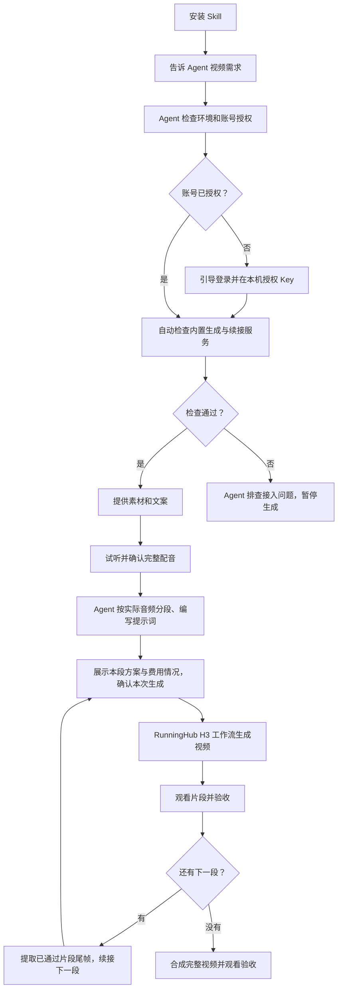

# 数字人口播视频 Skill

安装后，直接告诉 Agent 你想制作什么视频。未配置时，Agent 会先带你连接 RunningHub 账号，再整理人物 / 场景 / 产品素材与文案，生成片段、续接并合成为可审核的竖屏 MP4。

**无需自行准备 H3 工作流。** 视频生成与续接的默认配置由 Skill 提供，Agent 负责接入检查。

**Skill 可以独立使用。** 在对话里确认内容、试听配音和观看视频即可，无需启动工作台。

## 安装

把下面这句话发给能够安装 Skill 的 Agent：

```text
帮我安装这个 Skill：运行 npx skills add JasperCQ/talking-head-video-skill
```

或者自己在终端运行：

```sh
npx skills add JasperCQ/talking-head-video-skill
```

按安装器提示选择你使用的 Agent 和安装范围。终端需要可用的 Node.js / npm；如果不熟悉环境安装，也可以让 Agent 协助。支持的 Agent 及安装选项见 [skills 官方说明](https://github.com/vercel-labs/skills/blob/main/docs/commands.md)。

如需明确安装到 Codex，并在所有项目中使用：

```sh
npx skills add JasperCQ/talking-head-video-skill --skill talking-head-video --agent codex --global
```

安装完成后，若当前对话尚未识别到新 Skill，按所用 Agent 的加载方式刷新技能或开启新对话。

## 安装后怎么用

第一次使用，直接说：

```text
使用 talking-head-video，带我完成首次配置，然后制作一条数字人口播视频。
```

已经配置好后，可以这样说：

```text
使用 talking-head-video，根据我提供的人物图、场景图、产品图和口播文案制作竖屏视频。
我会提供完整配音。先给我确认内容，每次付费生成前展示方案，生成后让我观看验收。
```

支持 `$技能名` 调用的 Agent 也可以用 `$talking-head-video`。素材可通过当前 Agent 支持的附件或本地文件方式提供；任务文件、提示词和生成命令由 Agent 整理与执行。

## 第一次需要准备什么

| 你需要提供或授权 | Agent 会协助完成 |
| --- | --- |
| 自己的 RunningHub 账号、Key 授权和可用额度 | 引导账号授权，自动选择并检查内置视频生成与续接服务 |
| 人物图、场景图、产品图与口播内容 | 核对素材、整理文案、编写视频提示词与生产任务 |
| 完整配音，或有权使用的参考声音 | 导入配音，或检查并接入内置参考音色配音服务 |
| 对内容、每次付费生成和结果的确认 | 分段生成、查询结果、下载、尾帧续接与最终合成 |

Python 3.9+ 和 FFmpeg 由 Agent 检查并协助准备。第一次调用发现尚未授权账号时，会进入配置引导；已接通后沿用配置。你不需要提供工作流链接、ID 或手工导入工作流。

**安装 Skill 后还需要完成账号接入。** 视频使用你自己的 RunningHub 额度。内置服务仍受平台权限、模型和节点可用性影响；若检查失败，Agent 会排查并说明接入状态，不会让你另找 H3 工作流，也不会声称已经可生成。不要把 Key 发到聊天或提交到仓库。详细步骤供 Agent 查阅：[首次接入指南](references/setup.md#首次使用由-agent-引导)。

## 从需求到成片



首段使用 H3 基础工作流，后续连续镜头使用“已通过的尾帧 + 下一段配音”的续接工作流。视频通过 RunningHub 工作流 API 生成；最终由本地 FFmpeg 合成 1080×1920、24fps MP4，并保留完整配音。

每次付费生成都先展示具体方案。失败不会自动重试，未知提交结果会先核查；需要重做时另行确认。

## 当前验证范围

当前为测试版。已在当前账号跑通并人工验收通过：**导入已采用配音 → H3 首段 → 尾帧续接 → 完整成片**。本次样片约 6.48 秒；人物出现接触和抬杯等动作偏差，已披露并获准接受，不代表模型严格遵守全部动作约束。

- 样片配音来自另外生成的 MiniMax Speech 2.8 HD，作为完整音频导入；内置 Drama3 配音路线尚未完成真实生成验证。
- 已实测通过 `npx skills add` 从 GitHub 发现并安装本 Skill；本地安装测试覆盖内置默认配置和未授权时的首次配置引导，不发网络请求或提交生成。这不代替其他账号的云端生成验证。
- 默认生成配置已随 Skill 提供；其他账号对内置服务的访问权限尚未全面实测，需由 Agent 在账号授权后只读检查。首次真实生成仍需对应校准和人工验收。
- Skill 不会自动判断口型、产品真实性或画面质量，也不负责发布与投放。

## 更新

需要更新时，可以让 Agent 更新这个 Skill，或运行：

```sh
npx skills update talking-head-video
```

## 其他文档

- [首次接入指南](references/setup.md)：由 Agent 查阅并执行，账号授权后自动检查内置服务。
- [Skill 执行入口](SKILL.md) · [高级 CLI 与恢复](references/cli.md) · [接口与已知边界](references/api.md)。
- [可选审片工作台](references/workbench.md)：独立的集中查看入口，不参与 Skill 的安装和首次使用流程。

## 开发与来源

离线回归命令：`python3 -m unittest discover -s tests -v`。测试使用模拟网络与真实 WAV / FFmpeg 处理，覆盖生产控制、安装、审片及小数秒切点的 24fps 合成；测试通过不代表云端账号或画面质量验收通过。

基于 `talking-head-agent-kit-20261106` 重新整理为通用 Skill，保留音频先行、逐段审核、H3 工作流与中断恢复，移除固定品牌和飞书资产库依赖。模型与自定义节点遵循其各自授权条件，仓库不包含模型权重、账号配置、密钥或生产素材。
